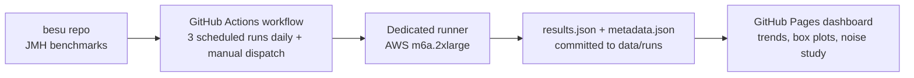

# Besu EVM Benchmarking Pipeline

This folder documents the continuous benchmarking pipeline for the Besu EVM. The pipeline runs Besu's JMH benchmarks every day on dedicated hardware, stores every result in this repository, and publishes a dashboard where performance trends and regressions can be seen.

## Architecture

The benchmarks themselves live in the [besu repository](https://github.com/besu-eth/besu) under `ethereum/core/src/jmh`. This repository holds the workflow that runs them, the results of every run, and the dashboard that displays those results. The dashboard is a static page served by GitHub Pages, it reads the stored JSON files directly and needs no server.

## Documentation pages

| Page | What it covers |
|---|---|
| [Running benchmarks](running-benchmarks.md) | How to run benchmarks locally and how to trigger the CI workflow manually |
| [The nightly pipeline](nightly-pipeline.md) | The daily schedule, what each run does, and how results are stored |
| [Reading the dashboard](reading-the-dashboard.md) | What every tab, column, and chart on the dashboard means |
| [Noise and significance](noise-and-significance.md) | How noisy the measurements are, and how to tell a real regression from noise |
| [Adding a new benchmark](adding-benchmarks.md) | How to write a benchmark so it appears in the nightly runs with gas metrics |

## Key metrics and terminology

**ns/op** is the primary number JMH reports, the average time one execution of the benchmarked operation takes, in nanoseconds. Lower is better.

**Error** is the plus or minus value JMH reports next to every score. It is the half width of a 99.9% confidence interval computed from the individual measurements inside the run. A score of 100 with an error of 2 means the true value is very likely between 98 and 102. A large error relative to the score means the measurements inside that run disagreed with each other, which makes the score less trustworthy.

**MGas/s** is million gas per second, the throughput measure the dashboard derives for each opcode benchmark. It is computed as gas cost divided by execution time, concretely `gas × 1000 / ns_per_op`. It answers the question of how much gas worth of this operation the EVM can execute per second. Higher is better. Benchmarks that are not gas wired show a dash in this column.

**CV**, coefficient of variation, measures stability across repeated runs of the same code. It is the standard deviation of the scores divided by their mean, expressed as a percentage. A CV of 1% means repeated runs land within about 1% of each other. The dashboard labels a benchmark stable below 5%, medium between 5% and 10%, and noisy at 10% or above.

**Baseline** is the earlier run a newer run is compared against. The dashboard always compares runs of the same kind, a run of latest main is compared against the previous run of latest main, and a pinned run against the previous pinned run.

**Forks** are the separate JVM processes JMH starts for one benchmark. Each fork warms up and measures independently, and the final score averages across all of them. The suite runs 5 forks with 5 measurement iterations each, so one score summarizes 25 measured iterations. Warmup iteration counts vary by benchmark class, most use 3.

## Caveats and known limitations

- All results come from one dedicated machine, an AWS m6a.2xlarge. Numbers are comparable with each other but not with results from other hardware.
- The BlockHash cold cache benchmark `executeOperationWithEmptyHashCache` is always excluded in CI. It accumulates state across invocations and runs out of memory, see [besu issue #11246](https://github.com/besu-eth/besu/issues/11246).
- EVM v2 benchmarks are excluded by default. They are not gas wired yet and will get their own separate run once EVM v2 work starts in earnest.
- MGas/s is only shown for benchmarks with a static gas cost that implement the gas wiring. Opcodes with dynamic gas costs show a dash.
- A green workflow run means the benchmarks executed, it does not by itself prove the results are sound. The noise and significance page explains how to judge the numbers.
